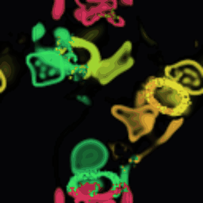
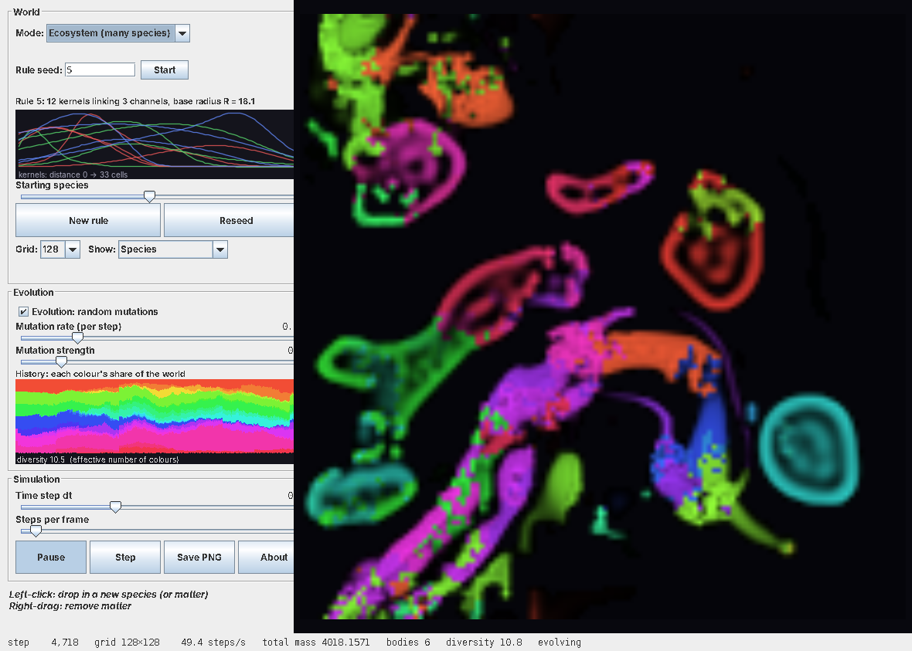
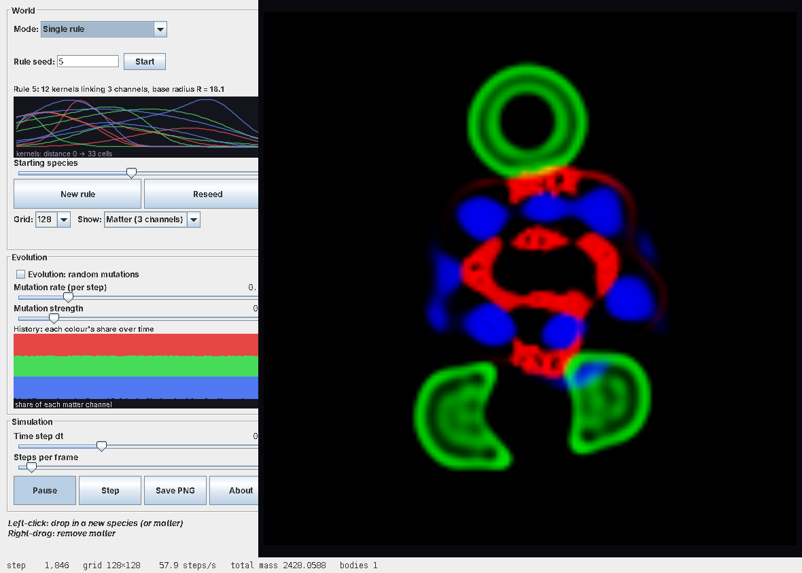
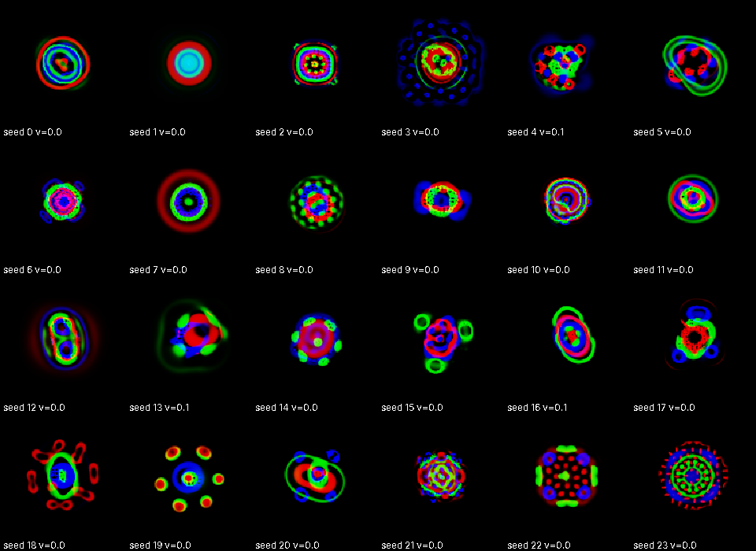
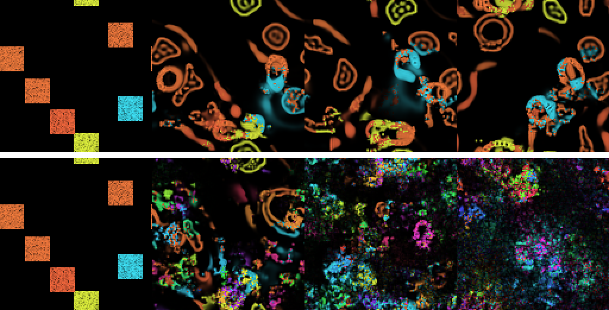

# Flow Lenia Lab

<p align="center">
  
</p>

**An ecosystem of artificial creatures: species that share a world, compete for territory and evolve.**

[Lenia](https://chakazul.github.io/lenia.html), created by **Bert Wang-Chak Chan**, is a world of smooth artificial creatures that glide, spin and heal. But it has two limits. Each world runs a single rule, so creatures of different species can never meet. And living matter can appear from nothing or vanish into nothing.

**Flow Lenia** removes both limits. It was introduced in 2023 by Erwan Plantec, Gautier Hamon, Mayalen Etcheverry, Pierre-Yves Oudeyer, Clément Moulin-Frier and Bert Wang-Chak Chan, in the paper [*Flow-Lenia: Towards open-ended evolution in cellular automata through mass conservation and parameter localization*](https://arxiv.org/abs/2212.07906). In Flow Lenia, matter is conserved and the rule travels with the creature. Different species can share one world, push against each other, merge and compete. With small random mutations, they can evolve.

**Flow Lenia Lab** lets you watch this on your own computer. It's an independent Java implementation, written from the equations in the paper. All the credit for the ideas belongs to the paper's authors.

You don't need to know any programming or mathematics. Start it and watch the colours.



---

## Getting started

Flow Lenia Lab is a single file. It needs **Java 17 or newer** and nothing else.

1. **Check whether you already have Java.** Open Terminal (on a Mac) or Command Prompt (on Windows) and type:

   ```
   java -version
   ```

   If it reports version 17 or higher, skip to step 3.

2. **Install Java if needed.** A free, trustworthy build is available from [Adoptium](https://adoptium.net). Download the installer for your computer and run it.

3. **Download** `FlowLeniaLab.java` from this repository.

4. **Run it.** In Terminal, go to the folder where you saved the file and type:

   ```
   java FlowLeniaLab.java
   ```

The window opens with six species scattered across the world. Within a few seconds they organise themselves into creatures.

---

## How Flow Lenia works

### Lenia, in one paragraph

In Lenia, every point in the world holds some amount of living matter. Each point senses a soft ring of its surroundings and passes what it senses through a growth curve. Where conditions are right, matter grows; elsewhere, it fades. With the right settings, this simple rule produces self-sustaining creatures. (For more, see **Lenia Lab**, this project's companion.)

### Two changes

Flow Lenia keeps Lenia's rings and growth curves, but changes two things.

**1. Growth becomes a force, and matter is conserved.** Instead of making matter appear or disappear, Flow Lenia uses the growth signal as a push. Matter **flows** towards places where conditions are better for growth, and away from places that are already crowded. It's then moved, never created or destroyed, using a method called *reintegration tracking*: each cell's matter is carried to its new position and shared out among the cells it lands on. The status bar shows the **total mass**, and it never changes. (Only your mouse can add or remove matter.)

**2. The rule travels with the matter.** The rule uses 12 ring-shaped kernels, linking three "channels" of matter. In the **Ecosystem** mode, every point in the world carries its own set of 12 weights saying how strongly each kernel matters to it. When matter flows, it takes its weights along. So a patch of matter with one set of weights behaves as one species, and a patch with different weights behaves as another, even in the same world. Where two species meet and their matter mixes, each point randomly inherits the weights of one of the incoming flows, in proportion to how much matter each brings.

### Evolution

Switch on **Evolution** and, every so often, a random square patch of the world has its weights nudged slightly. Any creature living there becomes a mutant. Most mutants fail or blend away. Some survive, spread and replace their ancestors. There is no fitness score and no goal: species succeed simply by persisting and taking up space.

---

## What you'll see

### The ecosystem

In the default **Species** view, each species has its own colour, worked out from its weights, so similar species get similar colours. Brightness shows how much matter is present. Creatures form membranes and internal structure, drift, and press against each other. Where two species meet, a speckled zone appears: contested ground, where both kinds of matter are mixing.

Press **Matter** in the *Show* menu to see the three channels of matter as red, green and blue instead.

### The history strip

The strip in the **Evolution** panel records the world's history. Each thin column is a moment in time, and its colours show each species' share of all the matter. Read it from left to right to watch lineages appear, grow, shrink and disappear. Underneath, **diversity** gives the *effective number of species*: 1 means one colour owns everything, and higher numbers mean the world is shared more evenly.

### Single-rule mode



Choose **Single rule** in the *Mode* menu for classic Flow Lenia: one rule for the whole world, and one creature seeded in the middle, shown as three channels of matter. Single creatures can be surprisingly intricate.

### A new rule every time



Press **New rule** to draw a completely new random set of kernels and growth curves, just as the paper's authors did in their random search. In testing, every one of 24 random rules produced a stable, self-contained creature, each with its own structure: rings, petals, satellites and cells within cells. Each rule is numbered by its **seed**, so you can return to one you like.

---

## Things to try

- **Watch an invasion.** Left-click to drop a new random species into a crowded ecosystem, and see whether it carves out territory or is absorbed.
- **Run evolution overnight.** Tick **Evolution**, set *Steps per frame* higher, and leave it running. Then read the story in the history strip.
- **Find your favourite rule.** Press **New rule** until a world catches your eye, and note its seed.
- **Look for movers.** Most random rules give creatures that stay roughly in place. A few creep across the world. In testing, the best of 14 rules moved 10 to 15 cells over a long run. Moving creatures are rare, which is why the paper's authors used searches to find them.
- **Cut and watch.** Right-drag through a creature to remove part of it, and watch whether it reforms.

---

## The controls

| Control | What it does |
|---|---|
| **Mode** | *Ecosystem*: many species, each carrying its own weights. *Single rule*: one rule for the whole world. |
| **Rule seed / Start** | Start the world with a numbered rule. |
| **New rule** | Draw a random new rule. |
| **Reseed** | Keep the rule and scatter fresh species. |
| **Starting species** | How many species the ecosystem starts with (1–12). |
| **Grid** | 128 or 256 cells across. 256 shows more, but runs about four times slower. |
| **Show** | *Species* colours by species; *Matter* shows the three channels as red, green and blue. |
| **Evolution** | Switch random mutations on or off. |
| **Mutation rate** | The chance per step that a mutation happens somewhere. |
| **Mutation strength** | How large each mutation is. |
| **Time step dt** | How far matter moves each step. The paper uses 0.2. |
| **Steps per frame** | How many steps are calculated between screen updates. |

**Using the mouse:** left-click drops in a new species (or a block of matter in single-rule mode); right-drag removes matter.

The small kernel plot shows the rule's 12 kernels as curves, coloured by the channel of matter each one feeds.

### A note on mutation strength



The reference model's mutation adds a full-sized random change each time. At a rate of one mutation every 20 steps, that dissolved every creature into noise within a couple of thousand steps (bottom row). So the lab defaults to a much gentler strength of 0.15. At that strength, creatures survive and new coloured variants appear. You can turn the strength up to see the difference for yourself.

---

## How faithful is it?

Flow Lenia Lab follows the model described in the paper and in the authors' published code: 3 channels and 12 kernels linked in a ring, the same kernel shapes, growth curves and random parameter ranges, the same rule for turning growth into flow, and reintegration tracking with the paper's settings (dt = 0.2, σ = 0.65). It is an **independent implementation**, written from the equations, not a copy of the authors' code. The world wraps around at its edges, while the authors' code defaults to walls. Random rules are numbered by seed in this lab's own scheme, so seeds don't match the authors' code.

In testing, the total mass stayed the same to ten significant figures over thousands of steps.

The calculation uses fast Fourier transforms, runs on all your computer's processor cores, and is written in plain Java with no extra libraries.

---

## Credits

**Flow Lenia** was created by Erwan Plantec, Gautier Hamon, Mayalen Etcheverry, Pierre-Yves Oudeyer, Clément Moulin-Frier and Bert Wang-Chak Chan.

- E. Plantec, G. Hamon, M. Etcheverry, P.-Y. Oudeyer, C. Moulin-Frier and B. W.-C. Chan, "Flow-Lenia: Towards open-ended evolution in cellular automata through mass conservation and parameter localization", ALIFE 2023: [arXiv:2212.07906](https://arxiv.org/abs/2212.07906)
- The authors' code (JAX): <https://github.com/erwanplantec/FlowLenia>
- Companion website: <https://sites.google.com/view/flowlenia>

**Lenia** was created by Bert Wang-Chak Chan.

- The Lenia portal: <https://chakazul.github.io/lenia.html>
- B. W.-C. Chan, "Lenia: Biology of Artificial Life", *Complex Systems* 28(3), 251–286 (2019): [arXiv:1812.05433](https://arxiv.org/abs/1812.05433)

**Flow Lenia Lab**
Architect: Mario Gianota
Implementation: Claude (Anthropic)

Released under the MIT licence.

If you enjoy this, try the companion labs: **Lenia Lab** (Bert Chan's creatures), **Primordial Soup Lab** (self-replicating code) and **Gray–Scott Lab** (chemical cells that divide).
